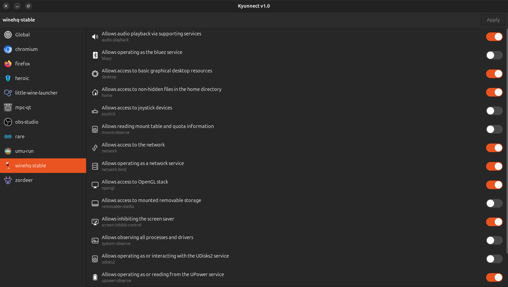

<h1 align="center">

   
  Kyunnect
</h1>

  A Snapd plug manager

Kyunnect can't manage all available plugs, only the simplest ones, such as removable-media, joystick, bluez, etc. 
The goal is to provide a simple way to connect and disconnect plugs without needing to use a terminal. 
Ubuntu Desktop already has something like this, but it's only within the Gnome settings; flavors can't be accessed.

  

